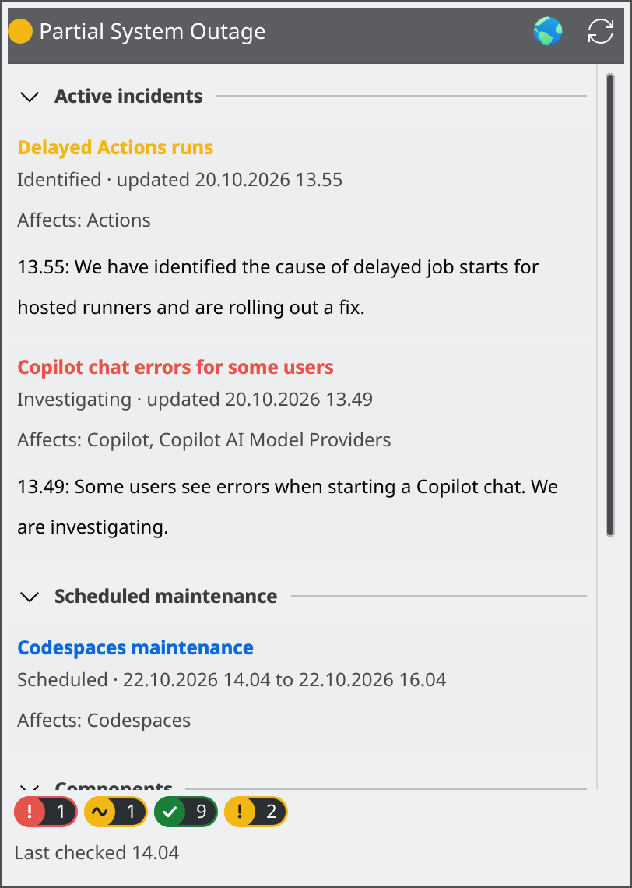
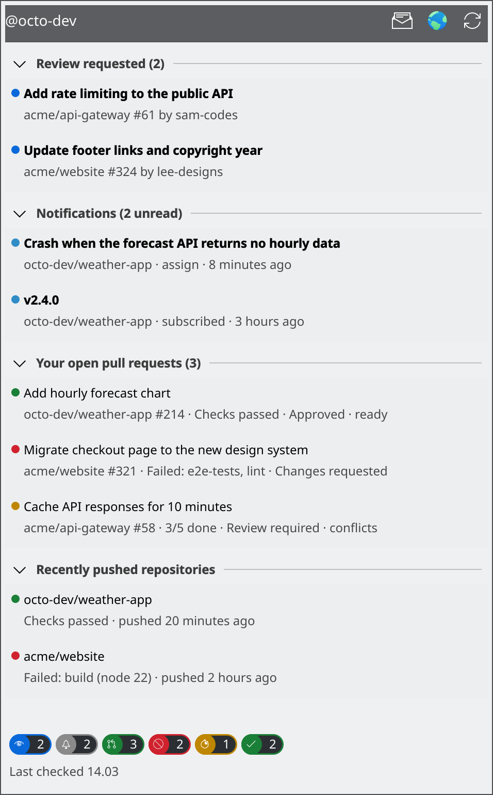
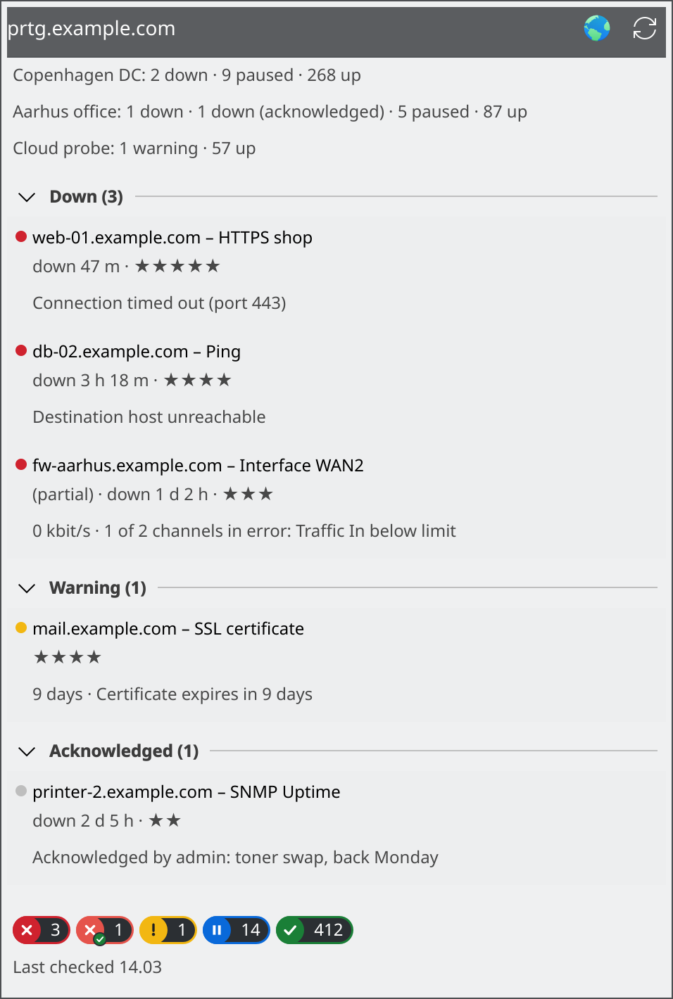
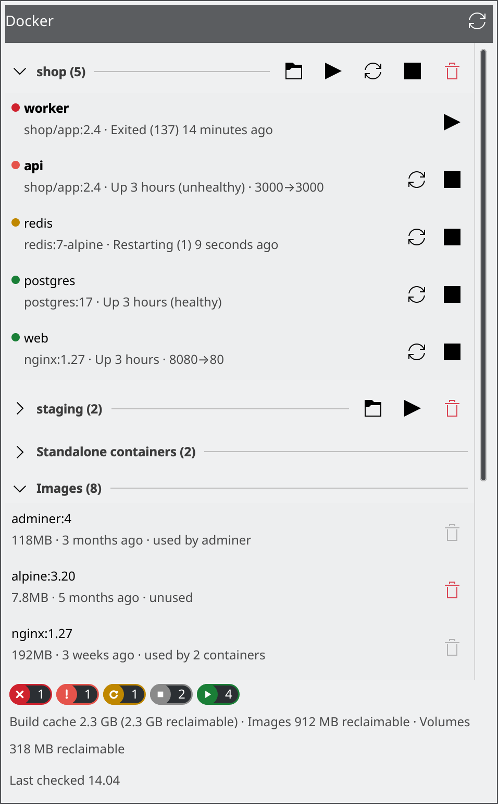
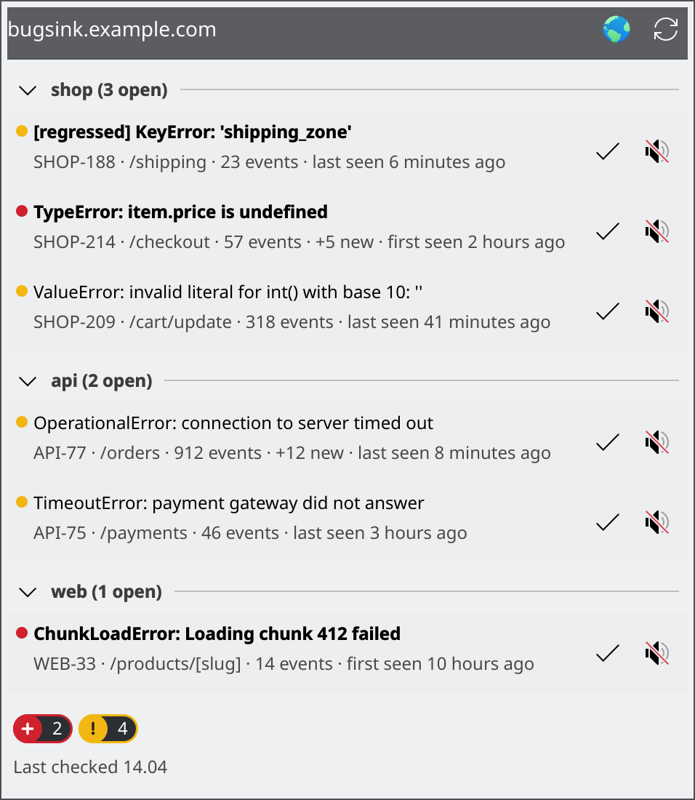
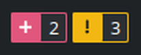
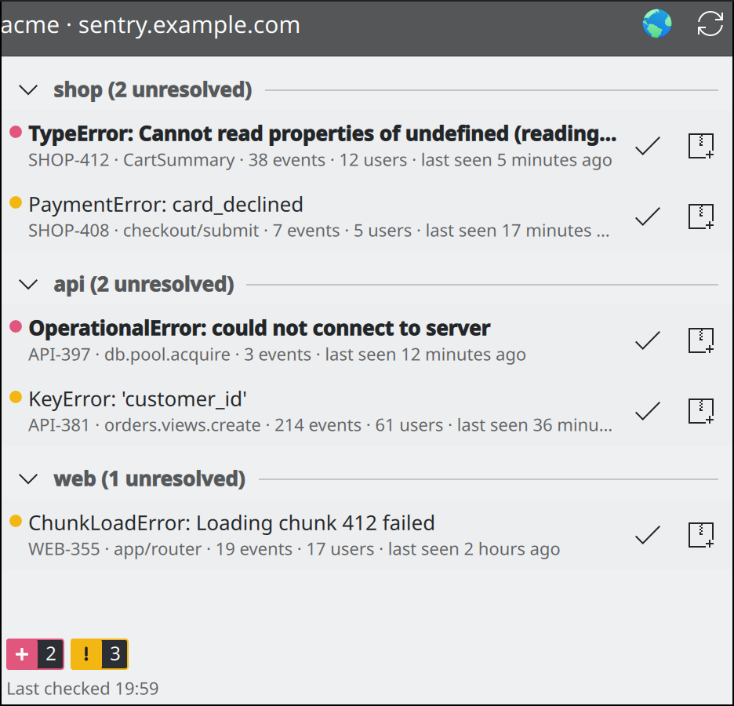
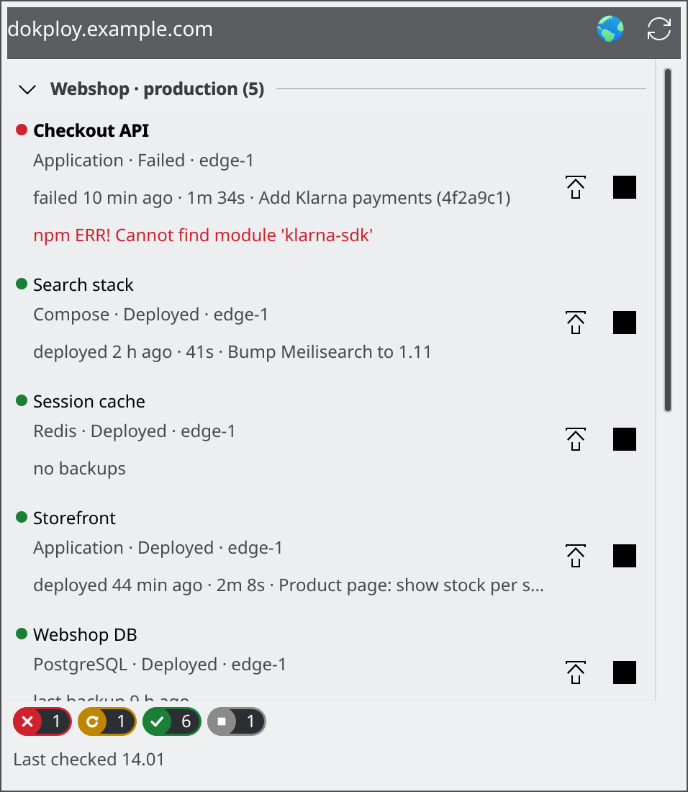
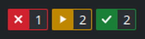
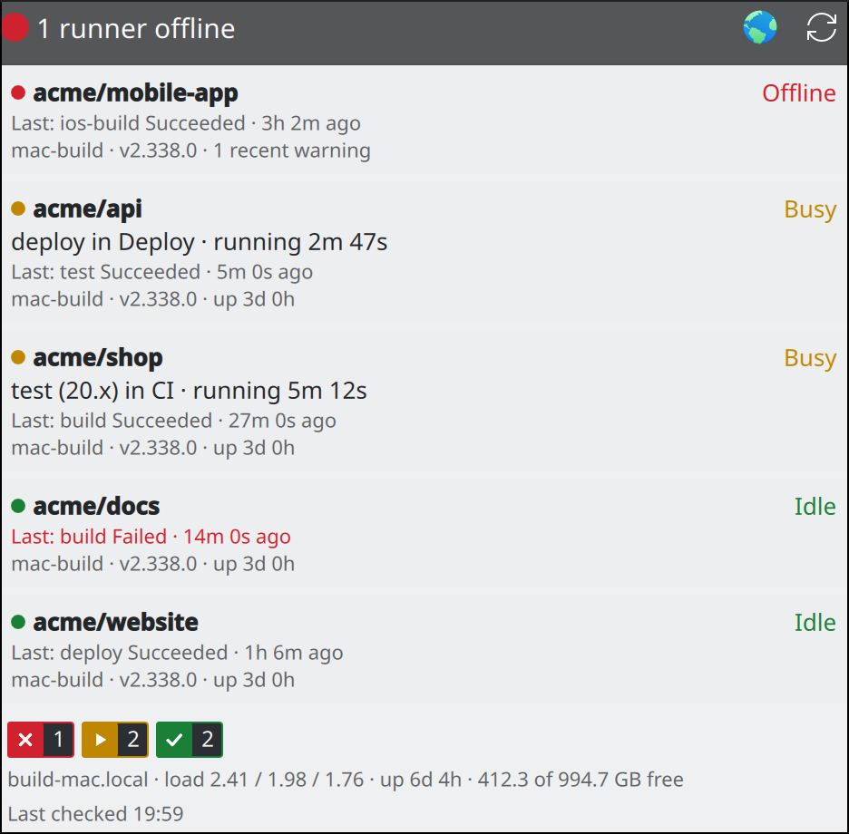

# Plasma Widgets

KDE Plasma 6 widgets for keeping an eye on GitHub, PRTG, Docker, Bugsink, Sentry, Dokploy, self-hosted GitHub Actions runners and local LLMs (Ollama) from the panel or desktop.

**Not on KDE Plasma?** The [Status Badges tray app](tray/) brings the same badges to Windows, macOS and any Linux desktop with a system tray.

| Widget | Id | Shows |
|---|---|---|
| [GitHub Status](githubstatus) | `dk.madebypless.githubstatus` | GitHub's service health from githubstatus.com as status badges per component state, with active incidents |
| [GitHub Account](githubaccount) | `dk.madebypless.githubaccount` | Count badges for review requests, notifications, open PRs and CI; click for the full lists. One widget per account. |
| [PRTG Status](prtgstatus) | `dk.madebypless.prtgstatus` | PRTG-style status badges (down, warning, unusual, paused, up…), with the problem sensors (and any other switched-on states) in a popup |
| [Docker Status](dockerstatus) | `dk.madebypless.dockerstatus` | Status badges for your containers (failed, unhealthy, restarting, paused, stopped, running), with start / stop / restart per container and per Compose stack |
| [Bugsink Status](bugsinkstatus) | `dk.madebypless.bugsinkstatus` | Status badges for your Bugsink issues (new, open, muted, resolved), with the open issues per project and resolve / mute buttons |
| [Sentry Status](sentrystatus) | `dk.madebypless.sentrystatus` | Status badges for your Sentry issues (new, open, archived, resolved), with the unresolved issues per project and resolve / archive buttons |
| [Dokploy Status](dokploystatus) | `dk.madebypless.dokploystatus` | Status badges for your Dokploy applications, Compose stacks and databases (failed, deploying, deployed, idle), with deploy / start / stop buttons |
| [Runner Status](runnerstatus) | `dk.madebypless.runnerstatus` | Status badges for self-hosted GitHub Actions runners (offline, busy, idle) and scheduled jobs (e.g. backups) from a [Mac server dashboard](https://github.com/pless84/mac-server-dashboard)'s `/api/status`, with the running job and last result per runner |
| [LLM Status](llmstatus) | `dk.madebypless.llmstatus` | A status badge with the GPU load and a loaded-models badge for an Ollama server (on this computer or another), with its loaded and installed models; or the LLM servers (Ollama, MLX) from a Mac server dashboard |

Every badge widget offers square or rounded badges, adjustable colours, a choice of which states get a badge, and an optional logo in front of the badges in the panel (any icon, or an image file such as a downloaded logo). Find these under **Appearance** and **General** in the widget's settings.

**Shared look.** To make all the widgets look the same, tick **Look the same as my other madebypless widgets** under **Appearance** (on by default) and change the badge style, spacing, logo or colours there. Applying saves them as the shared look in `~/.config/madebypless-widgets/look.json`, and every widget with the option on follows within a second or two. The shared colours are roles (error, attention, warning, active, info, OK, neutral, count background); each widget's settings page shows which of its states use each role. The logo image stays per widget, and untick the option on a widget to give it its own look again. Until a shared look is saved, every widget keeps its own settings.

## Screenshots

The screenshots show sample data, apart from GitHub Status, which shows the live public feed.

### GitHub Status

The panel shows a badge per component state (major outage, partial outage, degraded, maintenance, operational), like the other widgets. Under **Appearance** you can pick square or rounded badges, or the classic icon with a coloured status dot, and change the colours. Click for the per-component view:




### GitHub Account

The panel shows count badges for review requests, unread notifications, open pull requests, and CI failing / running / passing. Badges with a zero count are hidden, and the badge style (square or rounded) and every colour can be changed under **Appearance** in the widget's settings. Click for the full lists:




### PRTG Status

The panel shows a badge per sensor state, like PRTG's own status bar. Under **Appearance** in the widget's settings you can switch to a rounded style like PRTG's newer interface and change every colour. In the General settings you can pick which states get a badge (in the panel and the popup), show states with no sensors, and add the total (e.g. "(of 919)"). Click for the problem sensors, plus the unknown, paused or up sensors when their badge is switched on:




### Docker Status

The same badges for your Docker containers. Click for every container, grouped by Compose project, with start, stop and restart buttons for each container and for each whole stack:




A container counts as **failed** when it exited with an error. Exiting normally or being stopped with `docker stop` counts as **stopped**. A stack's buttons run `docker compose --project-name <project> start`, `stop` or `restart`, so they work without the compose file on hand (including on a remote context); they start the stack's existing containers rather than recreating them like `up` would. The settings let you pick the Docker context (e.g. a Podman machine or remote host), how often to check (default every 15 seconds), which states get a badge, the badge style and colours, and whether to notify you when a container fails or becomes unhealthy.

### Bugsink Status

Error tracking from a [Bugsink](https://www.bugsink.com/) server: badges for new (first seen in the last 24 hours), open, muted and resolved issues. Click for the open issues grouped by project. Click an issue to open it in Bugsink, or resolve or mute it from the popup:




Muted and resolved badges are off by default; switch them on under **Show badges**. Bugsink's API can't filter issues by status, so the widget reads each project's most recently seen issues (10 pages by default, adjustable) to count them.

### Sentry Status

The same idea for [Sentry](https://sentry.io/), on sentry.io or your own server: badges for new (first seen in the last 24 hours), open, archived and resolved issues across your organization. Click for the unresolved issues grouped by project. Click an issue to open it in Sentry, or resolve or archive it from the popup:





Archived and resolved badges are off by default; switch them on under **Show badges**. The counts come from Sentry's search and cover issues seen in the last 90 days. The popup lists the 100 most recently seen unresolved issues; you can raise that under **General**.

### Dokploy Status

Deployments from a [Dokploy](https://dokploy.com/) server: badges for failed, deploying, deployed and idle services, counting applications, Compose stacks and databases. Click for every service grouped by project and environment. Click a service to open it in Dokploy, or deploy, start or stop it from the popup:




While something is deploying, the widget checks every few seconds so you see the result straight away, and it notifies you when a deployment fails.

### Runner Status

Self-hosted GitHub Actions runners, read from a [Mac server dashboard](https://github.com/pless84/mac-server-dashboard)'s `/api/status` (set its address under **General**; it defaults to `http://192.168.1.217:8089`). The panel shows badges for offline, busy and idle runners. Click for every runner with its running job, last finished job and recent warnings, plus the host's load, uptime and free disk. Click a runner to open its job, or its repository's Actions page, on GitHub:





The widget checks every 15 seconds by default and notifies you when a runner goes offline or a job fails. A runner the dashboard reports as anything other than idle or busy counts as offline.

Local LLMs (Ollama, MLX) that the dashboard reports are shown by the [LLM Status](#llm-status) widget.

If the dashboard reports scheduled jobs (LaunchAgents that run on a schedule, such as a nightly backup), the popup gains a **Scheduled jobs** section: each job's schedule, when it last ran, when it runs next and the newest line of its log. While a job has failed (its last exit code isn't 0) or missed a scheduled run, the panel shows a red badge with the number of such jobs, and you get a notification when a job starts failing or fails again on a later run. Both can be turned off under **General**.

### LLM Status

Local LLMs at a glance. By default it talks to the Ollama server on this computer (`http://localhost:11434`; set another address under **General**) and reads this computer's GPU load through `nvidia-smi` or, for AMD cards, the kernel's counters. The panel shows two badges:

- **Status**: the GPU load, green while Ollama is up and the GPU idle, yellow while the GPU is busy (10% or more) and red when Ollama is down.
- **Loaded models**: how many models Ollama holds in memory (hidden when none is loaded, unless you switch that on).

Click for the server's version and address, each loaded model's size, how much of it sits on the GPU and when it unloads, and the installed models (collapsed by default). The widget checks every 10 seconds and notifies you when the server goes down.

Under **General** you can switch the source to a [Mac server dashboard](https://github.com/pless84/mac-server-dashboard) instead: the widget then shows the LLM servers it reports (Ollama and MLX) with the Mac's GPU, RAM and swap use, as Runner Status used to.

## Install

Download the widget's `.plasmoid` file from the [latest release](https://github.com/pless84/plasma-widgets/releases/latest). Then right-click the panel or desktop → **Add Widgets** → **Get New** → **Install Widget From Local File…**, or run:

```sh
kpackagetool6 -t Plasma/Applet -i githubstatus.plasmoid
```

Or install from a clone:

```sh
git clone https://github.com/pless84/plasma-widgets.git
cd plasma-widgets
kpackagetool6 -t Plasma/Applet -i githubstatus   # repeat for each widget you want
```

Then right-click the panel or desktop → **Add Widgets** and search for the widget's name.

To update after pulling changes, use `-u` instead of `-i`. A widget already on the panel picks up changes after `plasmashell --replace &` or a new login.

## Requirements

- Plasma 6
- **GitHub Account:** the [GitHub CLI](https://cli.github.com/) (`gh`), logged in with `gh auth login`. The widget uses its stored login and never handles a token itself. It can show any account `gh` is logged in to, picked in its settings, so you can add one widget per account. Run `gh auth login` again to add more accounts.
- **PRTG Status:** `curl` and `secret-tool` (libsecret), and PRTG 22.2 or newer for API keys.
- **Bugsink Status:** `python3` and `secret-tool` (libsecret), and a Bugsink API token. Create one in Bugsink under Tokens (`/bsmain/auth_tokens/`), paste it into the widget's settings and click **Save to Keyring**.
- **Sentry Status:** `python3` and `secret-tool` (libsecret), your organization's slug, and a Sentry personal token with the `event:read` and `event:write` scopes. Create one under User Settings → Personal Tokens, paste it into the widget's settings and click **Save to Keyring**. For an organization in the EU region, set the server to `https://de.sentry.io`.
- **Dokploy Status:** `python3` and `secret-tool` (libsecret), and a Dokploy API key. Generate one in Dokploy under Settings → Profile → API/CLI, paste it into the widget's settings and click **Save to Keyring**.
- **Docker Status:** the `docker` CLI with access to the daemon (e.g. your user in the `docker` group). Any `docker context` works, including Podman.

## PRTG setup

1. In PRTG, create a **read-only** API key: Setup → Account Settings → API Keys.
2. Open the widget's settings and enter the server address, e.g. `https://prtg.example.com`.
3. Paste the key into the **API key** field and click **Save to Keyring**. The page confirms when a key is stored for that server.

The key goes into your system keyring, never into the widget's settings file, and it's linked to the server address. Use `https`: over `http` the key is sent unencrypted, and the settings page warns you about that.

When the widget checks PRTG, the key is passed to `curl` on stdin, so it never shows up in the process list. Saving is the one exception: for a moment, while the key is being saved, it is part of a shell's command line.

You can also store the key from a terminal. The address must match the settings field exactly, without a trailing `/`:

```sh
wl-paste -n | secret-tool store --label="PRTG API key" service plasma-prtg server https://prtg.example.com
```

## Development

Preview a widget in its own window:

```sh
plasmawindowed dk.madebypless.githubstatus
```

`plasmoidviewer` from the `plasma-sdk` package is handy for testing panel and desktop layouts. QML errors from `plasmawindowed` go to the journal (`journalctl --user -f`).

Each widget's logic (parsing, counting, grouping, deciding what to notify about) lives in `contents/code/logic.js`, free of Plasma and i18n, so it can be tested without a desktop. `main.qml` imports it as `Logic` and keeps the UI, settings, translations and notifications. Run the tests with:

```sh
node --test 'tests/widgets/*.test.mjs'   # logic.js of every widget (Node 22 or newer, no npm packages)
python3 -m pytest tests/scripts          # the helper scripts, against a local fake server (needs pytest and curl)
```

The [Widgets workflow](.github/workflows/widgets.yml) runs both on every change.

## License

GPL-2.0-or-later. See [LICENSE](LICENSE).
